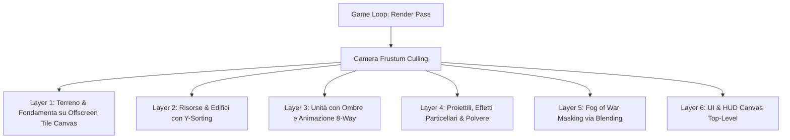
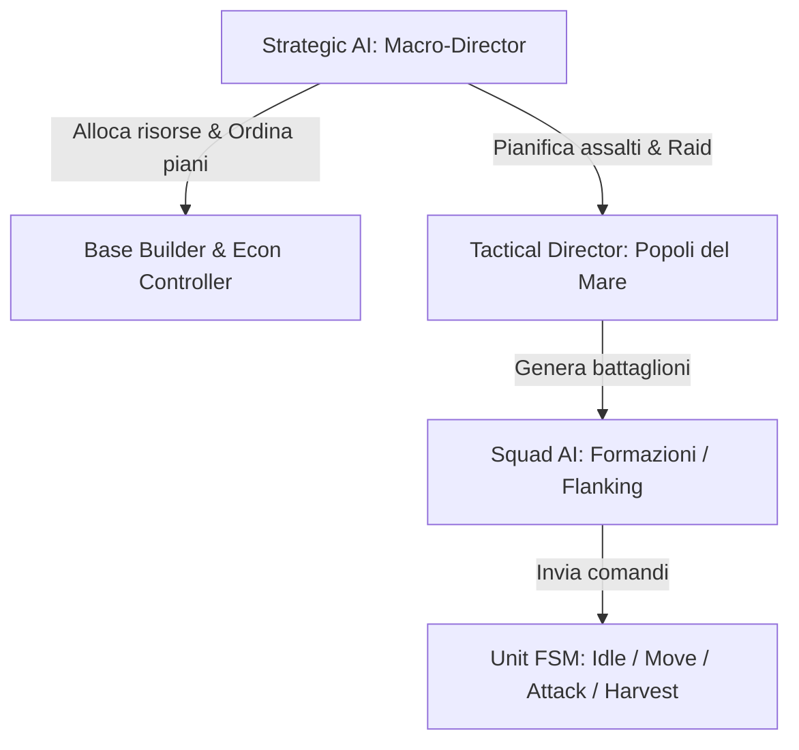
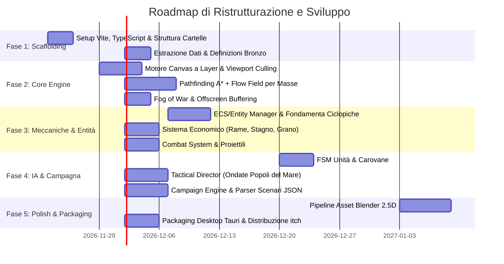

# Piano Architetturale: Ashes of Bronze (RTS 2.5D SVGA)
## Transizione e Modularizzazione dal Prototipo Monolitico allo Sviluppo Completo

---

## 1. Visione del Progetto e Transizione all'Età del Bronzo

Il progetto si evolve dal prototipo monolitico a tema romano (*Imperium Romanum*) verso l'ambientazione storica originale: **Il Collasso dell'Età del Bronzo e la Rivoluzione del Ferro (1200 – 900 a.C.)**.

### 1.1 Premessa Storico-Narrativa & Gameplay
* **Ambientazione:** Mediterraneo orientale ed Egeo post-1200 a.C. Le rotte commerciali collassano, i Popoli del Mare devastano le coste e le grandi città (Micene, Ugarit, Hattusa) crollano o lottano per la sopravvivenza.
* **Risorsa Chiave (Meccanica "Spezia di Dune"): lo Stagno (*Cassiterite*).**
  * Il rame è accessibile, ma senza stagno non è possibile forgiare il bronzo. La scarsità di rotte dello stagno forza spedizioni rischiose e guerre territoriali.
* **Transizione Tecnologica Epocale (Età del Ferro):**
  * Nella seconda metà della campagna (Atti II e III), il giocatore sblocca forni a mantice avanzati e la metallurgia del **Ferro**, superando la dipendenza dallo stagno e producendo armi più letali ed economiche.
* **Fondamenta Strutturali:**
  * Sostituzione delle lastre romane con **Terrapieni in Argilla e Pietra Ciclopica** (*Cyclopean Foundations*), indispensabili per erigere magazzini, fornaci e mura fortificate senza penalità di integrità.

---

## 2. Diagnosi del Prototipo Esistente (`imperium_romanum_strategia_svga_anni_90.html`)

Il prototipo attuale raccoglie in un unico file di oltre 3.600 righe tutte le logiche di rendering, input, simulazione, audio, dati e UI.

### 2.1 Punti di Forza da Mantenere
1. **Loop SVGA Retrò Autentico:** Look visivo solido (palette 256/High-Color anni '90, barre di selezione in rilievo, HUD scolpito).
2. **Ciclo Economico e Fondamenta:** Meccanica collaudata delle lastre di fondazione e dei raccoglitori/estrattori con drop-off automatico e controllo manuale.
3. **Web Audio Sintetico:** Generatore audio procedurale a zero dipendenze per BGM e SFX (ottimo fallback prima dell'inserimento di campioni audio dedicati).
4. **Controlli RTS Classici:** Box selection, doppi clic, gruppi rapidi (`Ctrl+1-9`), comandi contestuali con clic destro.

### 2.2 Debiti Tecnici Critici
| Componente Prototipo | Problema Attuale | Rischio Scalabilità |
| :--- | :--- | :--- |
| **Movimento / Pathfinding** | `moveUnitToward()` usa moto rettilineo con evitamento ostacoli ingenuo (step angolari 30°/60°). | Unità bloccate in vicoli ciechi, curve a U impossibili, collisioni a grappolo (*clumping*). |
| **Rendering Monolitico** | Tutto su un unico `CanvasRenderingContext2D`, iterando per ogni frame su canvas dimensionalmente non scalati e canvas procedurali ripetuti. | Frame rate crolla sopra 100 unità; nessun frustum/culling rigoroso; nessuna pipeline per spritesheet esterni. |
| **Logica di Stato Globale** | Variabili globali mutate ovunque (`mapTiles`, `units`, `buildings`, `projectiles`, `activeMission`). | Impossibile testare unità singole, difficile salvare/ripristinare lo stato, prono a race condition. |
| **IA Semplificata** | `updateEnemyAI()` è un timer hardcoded che produce unità a intervalli e le lancia in linea retta verso il palazzo del giocatore. | Nessuna tattica di accerchiamento, nessun ritiro strategico, nessuna gestione economica per la fazione nemica. |
| **Campagna Hardcoded** | 5 missioni cablate in `startMission(missionIdx)` con logiche imperativo-sequenziali nel codice. | Impossibile aggiungere missioni via JSON o modding; nessuna persistenza di veterani, tecnologie o decisioni strategiche. |

---

## 3. Stack Tecnologico Target & Struttura delle Directory

* **Linguaggio:** TypeScript (strict mode) per robustezza e tipizzazione delle entità RTS.
* **Bundler / Dev Environment:** Vite (HMR ultra-rapido per browser e bundling statico ottimizzato).
* **Target di Distribuzione:** Web Browser (itch.io demo) e Desktop Packaging via Tauri (Steam release multipiattaforma).
* **Rendering:** Canvas 2D ottimizzato con offscreen buffer per Fog of War e Tilemap + compatibilità WebGL per post-processing/palette shading.

### Struttura Directory Proposta

```text
ashes-of-bronze/
├── index.html
├── package.json
├── tsconfig.json
├── vite.config.ts
├── public/
│   ├── assets/
│   │   ├── sprites/       # Spritesheet PNG pre-renderizzati (Blender) + JSON metadata
│   │   ├── tiles/         # Biomi: coste egee, pianure levantine, steppe anatoliche
│   │   ├── audio/         # SFX ed echi vocali (con fallback al sintetizzatore)
│   │   └── ui/            # Cornici bronzo/pietra, icone risorse, ritratti
│   └── campaigns/         # File JSON per scenari e alberi decisionali
├── src/
│   ├── core/              # Game loop, Time, EventBus, Math (Vettori, Griglie)
│   ├── data/              # Definizioni dati: unità, edifici, tecnologie, biomi
│   ├── engine/
│   │   ├── camera/        # Camera2D, screen-to-world, viewport culling
│   │   ├── rendering/     # TileRenderer, SpriteRenderer, FogRenderer, UIRenderer
│   │   ├── pathfinding/   # Grid Graph, A*, Flow Field, Local Avoidance (RVO)
│   │   ├── spatial/       # Spatial Hash / QuadTree per query di raggio e collisioni
│   │   └── audio/         # SoundManager, AudioSynthesizer (Web Audio API), MusicPlayer
│   ├── entities/          # Gestione ECS / Oggetti: Unit, Building, ResourceNode, Projectile
│   ├── systems/
│   │   ├── EconomySystem.ts      # Stoccaggio, raccolte, carovane/carri, supply cap
│   │   ├── ProductionSystem.ts   # Code di costruzione, fondamenta, upgrade
│   │   ├── CombatSystem.ts       # Armi (arco, lancia, khopesh, carro), armature, danni
│   │   └── FogOfWarSystem.ts     # Calcolo visibilità a 3 stati (inesplorato/scoperto/visibile)
│   ├── ai/
│   │   ├── UnitFSM.ts            # State machine locale unità (Idle, Move, Attack, Harvest, Flee)
│   │   ├── StrategicAI.ts        # Macro-gestione nemica (economia, costruzione base)
│   │   ├── TacticalDirector.ts   # Ondate Popoli del Mare, raid costieri, assedi coordinati
│   │   └── InfluenceMap.ts       # Mappa di influenza pericolo/opportunità
│   ├── campaign/
│   │   ├── CampaignManager.ts    # Mappa strategica dell'Egeo, persistenza (Save/Load)
│   │   ├── ScenarioLoader.ts     # Parser scenari JSON, caricamento mappa
│   │   ├── ObjectiveSystem.ts    # Obiettivi primari/secondari, fail/win conditions
│   │   └── NarrativeSystem.ts    # Dialoghi consiglieri, tavolette cuneiformi, messaggi storici
│   ├── ui/
│   │   ├── HUDController.ts      # Risorse, barra di comando, inspector
│   │   ├── Minimap.ts            # Rendering radar/minimappa con fog integrata
│   │   ├── BuildMenu.ts          # Griglia costruzioni e piastre di fondazione
│   │   └── InputHandler.ts       # Selezione rettangolare, hotkey, comandi contestuali
│   └── main.ts                   # Bootstrap del gioco
└── tools/
    └── blender_export/           # Script Python per render 8 direzioni e fogli sprite
```

---

## 4. Moduli Architetturali di Dettaglio

### 4.1 Motore di Rendering 2.5D SVGA
Il rendering attuale ridisegna tutto ogni frame in coordinate canvas assolute. Il nuovo motore adotta una pipeline a layer con **Viewport Culling**:



1. **Tilemap Caching:** Il terreno statico viene renderizzato su blocchi di chunk pre-renderizzati (es. 16x16 tile) per minimizzare i `drawImage` al secondo.
2. **Y-Sorting Profondità:** Edifici ciclopici e unità vengono inseriti in una lista z-order ordinata per coordinata `Y + offset`, garantendo la corretta occlusione 2.5D.
3. **Fog of War a 3 Stati:**
   * Mantenuto su un `Uint8Array` a griglia: `0 = Inesplorato (Nero)`, `1 = Esplorato ma non visibile (Ombra)`, `2 = Visibile in tempo reale`.
   * Renderizzato con gradiente radiale morbido per eliminare l'effetto a scacchiera netta.
4. **Sprite System Ibrido:**
   * Supporto prioritario per atlanti spritesheet esportati da Blender (8 direzioni: N, NE, E, SE, S, SW, W, NW).
   * Fallback procedurale per retrocompatibilità con gli asset procedurali SVG/Canvas del prototipo.

---

### 4.2 Navigazione, Griglia e Pathfinding
Il limite maggiore del prototipo è l'assenza di un vero algoritmo di instradamento.

#### A* Gerarchico e Flow Fields per RTS
* **Livello Macro (Griglia 48x48 o 96x96):**
  * Costruzione del grafo di calpestabilità: piastre di fondazione aumentano la velocità di transito (+15%), terreni rocciosi/paludi la riducono, fiumi e rilievi ciclopici sono invalicabili.
  * **A\* con Jump Point Search (JPS):** Ottimale per comandi di unità singole o piccoli gruppi.
* **Livello Micro (Flow Field per Masse / Ondate):**
  * Quando un'ondata di 30 predoni dei Popoli del Mare attacca la città, calcolare 30 percorsi A* satura la CPU.
  * Il sistema genera una **Mappa dei Vettori di Flusso (Flow Field)** generata con Dijkstra partendo dal target (la porta o il granaio della città). Tutte le unità dell'ondata leggono il vettore locale istantaneamente in $O(1)$.
* **Evitamento Locale Dinamico (Steering / RVO):**
  * Le unità mantengono un raggio di separazione elastico per non sovrapporsi e formare formazioni credibili (falange o linea d'assalto).

---

### 4.3 Sistema di Intelligenza Artificiale (IA)

L'IA viene scomposta in tre livelli cooperativi:



1. **Unit FSM (Stato Locale):**
   * Stati: `IDLE`, `MOVE_TO`, `ATTACK_TARGET`, `HARVEST_CYCLE` (MoveToNode -> Mine -> ReturnDropoff -> Unload), `FLEE`, `PATROL`.
2. **Carovane & Harvester Economici:**
   * Gli asinelli/carri estrattori selezionano autonomamente il giacimento di Stagno o Rame più sicuro e vicino. Se attaccati, inviano un segnale di soccorso al sistema di allarmi della base e ripiegano verso le mura più vicine.
3. **Tactical Director (Ondate Asimmetriche dei Popoli del Mare):**
   * Non semplici timer: l'IA analizza i punti deboli della base del giocatore (assenza di torri di guardia, varchi nelle mura, depositi di grano sguarniti) ed esegue sbarchi navali o raid fulminei da settori imprevisti.
4. **Base Enemy AI (Città Rivali):**
   * Gestione autonoma del tech tree: estrae risorse, costruisce caserme, ricerca la tecnologia del ferro quando disponibile.

---

### 4.4 Definizione della Campagna & Architettura Scenari

La campagna dell'Età del Bronzo non sarà codificata in funzioni JS monolitiche, ma definita attraverso file di configurazione dichiarativi (JSON con schema validato).

#### Struttura di uno Scenario (`scenario_schema.json`)
```json
{
  "id": "scenario_03_ugarit_fall",
  "title": "La Caduta di Ugarit",
  "act": 1,
  "era": "late_bronze",
  "map": {
    "width": 64,
    "height": 64,
    "biome": "levantine_coast",
    "seed": 1177,
    "decorations": ["palms", "ancient_ruins", "beaches"]
  },
  "player": {
    "faction": "city_state_survivors",
    "resources": { "copper": 600, "tin": 150, "grain": 300, "iron": 0 },
    "startLocation": { "x": 12, "y": 48 },
    "unlockedBuildings": ["cyclopean_slab", "acropolis", "granary", "bronze_foundry", "watchtower", "barracks"],
    "unlockedUnits": ["spearman_militia", "skirmisher", "donkey_caravan"]
  },
  "opponents": [
    {
      "id": "sea_peoples_raiders",
      "faction": "sherden_sea_peoples",
      "aiProfile": "aggressive_raider",
      "spawnWaves": [
        { "triggerTimeSeconds": 180, "units": [{ "type": "sea_raider_swordsman", "count": 6 }], "spawnEdge": "west_sea" },
        { "triggerTimeSeconds": 360, "units": [{ "type": "sea_raider_swordsman", "count": 10 }, { "type": "archer", "count": 4 }], "spawnEdge": "west_sea" }
      ]
    }
  ],
  "objectives": {
    "primary": [
      { "id": "secure_tin_mine", "type": "protect_resource_nodes", "target": "tin_vein_north", "description": "Difendi la cava di stagno settentrionale." },
      { "id": "survive_time", "type": "survive_waves", "targetSeconds": 600, "description": "Resisti agli sbarchi dei Popoli del Mare per 10 minuti." }
    ],
    "secondary": [
      { "id": "build_port", "type": "construct_building", "buildingType": "coastal_refuge", "description": "Costruisci un rifugio costiero per accogliere i profughi." }
    ]
  },
  "narrative": {
    "briefing": "Le lettere cuneiformi avvertono: le navi nemiche bruciano le nostre città costiere...",
    "advisorPortrait": "ugarit_elder",
    "dialogueTriggers": [
      { "condition": "first_wave_sighted", "message": "Allarme! Navi straniere con elmi cornuti si avvicinano alla costa!" }
    ]
  }
}
```

#### Persistenza e Campagna a Nodi Strategici
* Mappa strategica dell'Egeo/Mediterraneo Orientale: il giocatore seleziona la prossima regione da liberare/difendere.
* Salvataggio unificato in `localStorage` o file JSON locale (Tauri desktop API) che memorizza:
  * Livello di ricerca tecnologica (scoperta del ferro, forgiatura avanzata).
  * Risorse globali accumulate.
  * Squadre di veterani promossi tra le missioni.

---

## 5. Adattamento Tematico: Unità, Edifici e Risorse

| Categoria | Prototipo (Romano) | Ashes of Bronze (Età del Bronzo / Ferro) | Meccanica Chiave |
| :--- | :--- | :--- | :--- |
| **Fondamenta** | *Lastricato Romano* | **Terrapieni Ciclopici in Pietra e Fango** | Gli edifici senza terrapieno hanno il 50% di PF in meno. |
| **Risorsa 1** | *Denarii / Oro* | **Rame (*Copper*)** | Metallo base per l'economia e la produzione primaria. |
| **Risorsa 2** | *Pietra Cava* | **Stagno (*Tin - Cassiterite*)** | Raro, necessario in rapporto 1:9 col rame per unità in bronzo. |
| **Risorsa Avanzata** | *N/A* | **Ferro (*Iron*)** | Sbloccato nell'Atto II/III; sostituisce rame+stagno rendendo le armi più economiche e letali. |
| **Risorsa Cibo** | *Viveri / Grano* | **Grano & Bestiame (*Grain & Herds*)** | Mantiene il cap della popolazione; prodotto da Campi Irrigati e Graniere. |
| **Unità Raccolta** | *Carro Raccoglitore* | **Carovana d'Assedio / Asino con Ceste** | Raccoglie dai nodi di metallo e scarica alla Fonderia. Controllabile a mano. |
| **Fanteria Base** | *Legionario* | **Lancieri con Scudo a Torre / Fanteria Micenea** | Bonus difensivo se uniti in formazioni compatte. |
| **Fanteria Rapida** | *Scout Equite* | **Guerrieri Shardana / Popoli del Mare (Khopesh)** | Fanteria d'assalto rapida con armi ricurve in bronzo. |
| **Cavalleria / Mezzi** | *Catapulta / Balista* | **Carri da Guerra a 2 Cavalli (*Chariots*)** | Unità mobili da tiro e sfondamento, dominatrici delle pianure dell'Età del Bronzo. |
| **Assedio Avanzato** | *Onagro Pesante* | **Ariete Coperto / Balista d'Assedio Ittita** | Distruzione mura e palazzi ciclopici nemici. |

---

## 6. Piano di Implementazione a Fasi



### Prossimi Passi Operativi Immediati:
1. Inizializzare la struttura del progetto con `package.json`, configurazione TypeScript e Vite.
2. Trasferire e tipizzare i dati di gioco (`TERRAIN`, `BUILDING_DEFS`, `UNIT_DEFS`) adattandoli all'Età del Bronzo.
3. Estrarre il motore audio sintetico (`RomanAudio` -> `BronzeAudioEngine`) in un modulo isolato.
4. Creare il modulo di Pathfinding A* e Flow Field per sostituire il moto rettilineo del prototipo.
