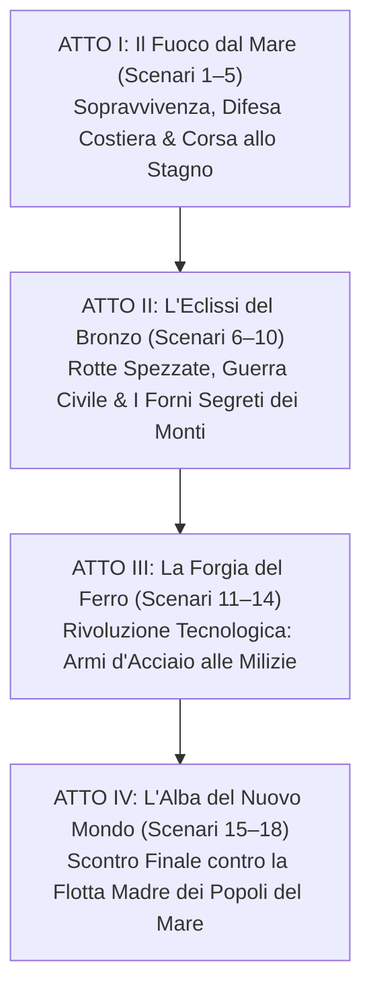
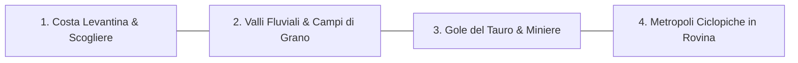

# Ashes of Bronze: The Iron Dawn
## Documento Narrativo, Sceneggiatura e Ambientazioni (1200 – 900 a.C.)

---

## 1. Premessa Storica & Visione Narrativa

### 1.1 Il Mondo al Collasso (Anno 1177 a.C.)
Per secoli, il Mediterraneo Orientale è stato una ragnatela cosmopolita di superpotenze connesse da un commercio marittimo d'oro e metalli: il **Grande Egitto del Nuovo Regno**, il **Regno Ittita di Hatti**, i signori guerrieri di **Micene**, e le ricchissime città-stato mercantili della costa come **Ugarit** e **Byblos**.

Questo intero sistema globale si reggeva su un unico, fragile pilastro: **il Bronzo**.
Per forgiare il bronzo servono 9 parti di Rame e 1 parte di **Stagno**.
* Il rame era ovunque (specialmente a Cipro, *Alashiya*).
* Lo **stagno**, invece, era la risorsa più preziosa e sfuggente del pianeta: viaggiava per migliaia di chilometri da remote montagne dell'Asia Centrale e dell'Iberia attraverso fragili rotte marittime.

Nel 1200 a.C., la catastrofe: una combinazione letale di siccità prolungate, carestie, terremoti a catena e disordini sociali manda in frantumi le rotte carovaniere. In questo vuoto di potere piombano i **Popoli del Mare** (*Shardana, Peleset, Denyen, Lukka, Weshesh*): confederazioni di guerrieri nomadi della navigazione, spinti dalla fame e dalla furia, che distruggono sistematicamente ogni porto, palazzo e miniera.

> *"Padre mio, le navi del nemico sono giunte; hanno dato fuoco alle nostre città e compiuto atrocità nel paese... La nostra terra è abbandonata a se stessa."*  
> — Dalle ultime lettere cuneiformi di Ugarit (Tavoletta RS 20.238, 1185 a.C.)

---

## 2. Il Protagonista e la Fazione del Giocatore

Il giocatore assume il ruolo del **Wanax / En** (Sovrano e Signore della Guerra) di una città-stato portuale e fortezza superstite situata tra la costa del Levante e i piedi dei monti dell'Anatolia (chiamata nel gioco **Kadesh-sul-Mare** o **Kar-Sur**).

Circondato da imperi in cenere, il tuo popolo non combatte per la gloria o per la conquista imperiale, ma per **impedire che la civiltà stessa si estingua nell'oscurità**.

### 2.1 I Consiglieri della Corte (Voci Narranti del Gioco)

| Personaggio | Ruolo Narrativo | Voce nel Gameplay / Advisor |
| :--- | :--- | :--- |
| **Burna-Khabir** | *Primo Scriba dell'Archivio Cuneiforme* | Interpreta le lettere d'argilla dai regni vicini; notifica eventi della campagna, presagi, condizioni di vittoria e tregue diplomatiche. Voce saggia e solenne. |
| **Tarkhunta** | *Gran Maestro dei Forni e della Forgia* | Gestisce l'economia metallurgica. All'inizio lamenta disperatamente l'esaurimento dei lingotti di stagno; successivamente guiderà l'esperimento rivoluzionario per fondere il ferro grezzo delle montagne. |
| **Zalpa** | *Capitana delle Sentinelle e degli Esploratori* | Occhio sul campo; avvisa degli sbarchi navali nemici, individua giacimenti nascosti e comanda i reparti di carri d'assalto veloci. |

---

## 3. Sceneggiatura della Campagna: Arco Narrativo in 4 Atti (18 Scenari)

---

### ATTO I: Il Fuoco dal Mare (Scenari 1 – 5)
* **Tema centrale:** Difesa disperata, shock culturale, scarsità improvvisa di risorse.
* **Trama:**
  * **Scenario 1: *Le Vele con le Corna*.** Prime navi da guerra con guerrieri con elmo piumato e cornuto assaltano i villaggi costieri. Il giocatore deve radunare i superstiti, costruire terrapieni ciclopici d'emergenza ed evacuare i pescatori.
  * **Scenario 2: *L'Ultimo Carico di Alashiya*.** Una flotta mercantile proveniente da Cipro con un carico di rame e stagno naufraga tra le scogliere. Corsa contro il tempo per estrarre il carico prima che i predoni Shardana brucino i relitti.
  * **Scenario 3: *La Porta dei Cedri*.** I Popoli del Mare tentano di tagliare i rifornimenti di legname e grano incendiando le fattorie della valle. Prima introduzione dei carri da guerra per pattugliare le pianure.
  * **Scenario 4: *Assedio a Kadesh-sul-Mare*.** Prima grande battaglia d'assedio: le torri di vedetta e le mura ciclopiche reggono all'assalto notturno di centinaia di predoni.
  * **Scenario 5: *Il Silenzio dei Grandi Re*.** Messaggeri arrivano con tavolette spezzate: Hattusa è bruciata, Micene è caduta, l'Egitto ha chiuso i confini del Delta. Il mercato globale è morto: non arriverà mai più stagno dall'oltremare.

---

### ATTO II: L'Eclissi del Bronzo (Scenari 6 – 10)
* **Tema centrale:** Il collasso delle risorse nobili, guerre fratricide tra sopravvissuti, spedizione nell'ignoto.
* **Trama:**
  * **Scenario 6: *La Guerra degli Stracci e del Bronzo*.** Le città-stato vicine, disperate per la mancanza di metallo per le armature, attaccano le nostre carovane. Scontro fratricida per l'ultimo nodo di cassiterite (stagno).
  * **Scenario 7: *Nel Cuore delle Gole di Pietra*.** Esaurito lo stagno, la città non può più equipaggiare nuovi soldati d'élite. Tarkhunta propone una spedizione proibita verso le montagne del Tauro, terre selvagge di tribù montane che forgiano "pietre scure cadute dal cielo".
  * **Scenario 8: *L'Imboscata dei Popoli del Fiume*.** Avanzata in gole strette dove i carri non possono manovrare. Battaglia tattica di fanteria leggera, frombolieri e trappole.
  * **Scenario 9: *I Fabbri Eretici*.** Incontro con una casta di artigiani montani che estraggono minerale di ferro e lo scaldano con forni a mantice doppio. Protezione del loro villaggio da un'incursione punitiva dei mercenari rivali.
  * **Scenario 10: *La Prima Lama Nera*.** Rientro alla capitale mentre una colonna d'invasione tenta di distruggere i convogli di minerale. Tarkhunta presenta la prima spada in ferro forgiato: fragile e rozza rispetto al bronzo lucido, ma ricavabile da roccia abbondante e senza bisogno di stagno.

---

### ATTO III: La Forgia del Ferro (Scenari 11 – 14)
* **Tema centrale:** La democratizzazione della guerra, industrializzazione arcaica, ribaltamento dei rapporti di forza.
* **Trama:**
  * **Scenario 11: *Fiamme nel Bosco Sacro*.** Costruzione del primo grande distretto di Forni di Riduzione del Ferro. Produzione massiccia di armi in ferro battuto.
  * **Scenario 12: *L'Esercito del Popolo*.** Nel vecchio mondo del bronzo, solo l'aristocrazia sui carri poteva permettersi corazza e spada. Con il ferro, il giocatore arma centinaia di contadini e miliziani. Primo scontro campale in cui la fanteria economica in ferro sbaraglia i vecchi e costosissimi carri di bronzo di una dinastia rivale.
  * **Scenario 13: *Liberazione della Valle dell'Oronte*.** Riconquista dei granai e delle rotte fluviali perdute; bonifica dei territori occupati dai predoni Lukka.
  * **Scenario 14: *I Forgiatori del Levante*.** La notizia della nuova metallurgia si diffonde. Una coalizione di signori della guerra tenta di impadronirsi dei forni. Difesa coordinata con truppe pesanti d'assalto dotate di picche e scudi rinforzati in ferro.

---

### ATTO IV: L'Alba del Nuovo Mondo (Scenari 15 – 18)
* **Tema centrale:** Il confronto finale epocale, la sconfitta della marea nomade, rinascita della civiltà.
* **Trama:**
  * **Scenario 15: *La Notte dei Moli Bruciati*.** I capi dei Popoli del Mare comprendono che Kadesh-sul-Mare è l'ultimo bastione organizzato che impedisce il loro dominio totale sulla costa. Sbarchi su larga scala su tre fronti.
  * **Scenario 16: *La Battaglia delle Fauci di Pietra*.** Imboscata titanica in una valle fortificata: utilizzo di baliste arcaiche montate su terrapieni e barriere di fuoco per incanalare l'orda nemica.
  * **Scenario 17: *Il Giudizio di Alashiya*.** Spedizione navale di contrattacco verso Cipro per sradicare la roccaforte marittima principale dei predoni Shardana e liberare le rotte del Mediterraneo.
  * **Scenario 18: *L'Alba d'Acciaio*.** L'ultimo Re dei Popoli del Mare assedia la capitale con macchine d'assedio catturate e un'armata oceanica. Difesa a oltranza e contrattacco finale con l'esercito d'acciaio. La vittoria segna la fine dell'Età del Bronzo e l'inizio della nuova civiltà del Ferro.

---

## 4. Le Ambientazioni & I Biomi

Il gioco attraversa quattro grandi biomi visivi e tattici, ciascuno con implicazioni sul gameplay:

### 1. Costa Levantina & Scogliere d'Egeo
* **Estetica:** Acque turchesi, banchi di sabbia dorata, palme da dattero, scogliere di roccia bianca e relitti di navi rovesciate.
* **Gameplay:** Terreno vulnerabile a sbarchi rapidi; la sabbia riduce la velocità dei carri del 25%; l'acqua salata è un ostacolo naturale ma i guadi permettono raid a sorpresa.

### 2. Valli Fluviali Alluvionali (Oronte ed Eufrate)
* **Estetica:** Terreni d'argilla bruna, canneti fluviali, canali d'irrigazione geometrici e ampi campi di grano dorato.
* **Gameplay:** Altissima resa economica per i granai; terreno ideale per la carica dei carri da guerra a due cavalli; fiumi attraversabili solo tramite ponti di chiatte o guadi fortificabili.

### 3. Altipiani del Tauro e Gole Anatoliche
* **Estetica:** Roccia scura e calcarea, pini montani sparsi, crepacci impervi e fumo denso che sale dai forni rupestri.
* **Gameplay:** Nessun carro consentito o forte penalità di movimento; terreno dominato da schermagliatori, arcieri e imboscate da posizioni elevate; sede dei ricchi nodi di rame e delle uniche cave di minerale di ferro.

### 4. Città Fortificate e Rovine Ciclopiche
* **Estetica:** Mura megalitiche con blocchi di pietra poligonale incastrati a secco, porte dei leoni, palazzi a megaron con pilastri di cedro dipinti di rosso ocra e ziggurat scalinate.
* **Gameplay:** Punti di strozzatura brutali; le fondamenta ciclopiche sono indispensabili per montare torri d'artiglieria arcaica e resistere agli arieti coperti.

---

## 5. Tono dei Dialoghi e Documenti Storici

La narrazione in-game viene presentata attraverso:
1. **Tavolette Cuneiformi e Sigilli Cilindrici:** Il briefing di ogni missione si apre con il calco di una tavoletta d'argilla incisa in caratteri cuneiformi o geroglifici arcaici, tradotta dalla voce del consigliere Burna-Khabir.
2. **Messaggeri a Cavallo e Fumo di Segnalazione:** Gli allarmi durante la partita arrivano con effetti sonori di corni d'ariete o bronzi percorsi, con messaggi concisi e drammatici:
   * *"Mio Signore! Il fumo sale dal promontorio di Byblos: le navi dai becchi d'uccello sono entrate nel porto!"*
   * *"Tarkhunta ci avverte: le scorte di stagno sono a zero. I fabbri non possono completare la corazza dei carri."*
   * *"I forni cantano con il minerale nero della montagna: le nuove picche sono pronte per le milizie."*
