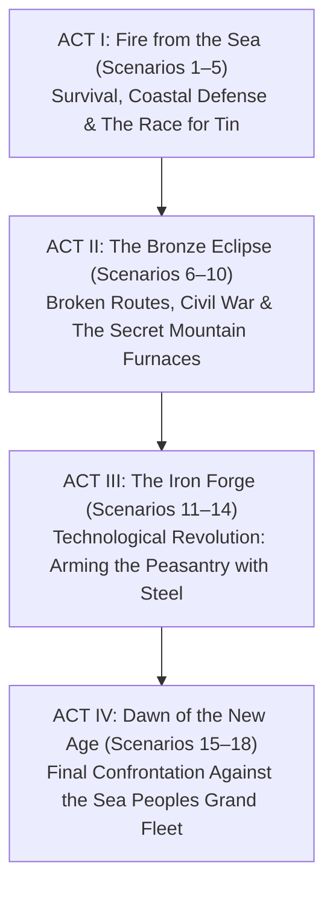

# Ashes of Bronze: The Iron Dawn
## Narrative Document, Screenplay, and Settings (1200 – 900 BC)

---

## 1. Historical Premise & Narrative Vision

### 1.1 The World in Collapse (Year 1177 BC)
For centuries, the Eastern Mediterranean was a thriving cosmopolitan network of superpowers bound by maritime trade in gold and metals: the **New Kingdom of Egypt**, the **Hittite Empire of Hatti**, the warlords of **Mycenae**, and wealthy coastal merchant city-states such as **Ugarit** and **Byblos**.

This entire globalized bronze economy rested on a single fragile pillar: **Bronze**.
Forging bronze requires 9 parts Copper and 1 part **Tin**.
* Copper was abundant (especially on Cyprus, *Alashiya*).
* **Tin**, however, was the rarest and most elusive resource in the ancient world: it traveled thousands of kilometers along tenuous overland and maritime routes from remote mountains in Central Asia and Iberia.

Around 1200 BC, catastrophe struck: severe prolonged droughts, widespread famine, earthquake storms, and social rebellions shattered these vital trade networks. Into this power vacuum surged the **Sea Peoples** (*Shardana, Peleset, Denyen, Lukka, Weshesh*): seaward warrior confederations driven by hunger and fury, systematically sacking every port, palace, and mine across the Mediterranean.

> *"My father, the ships of the enemy have come; they have burned our cities and committed atrocities in the land... Our country is left unto itself."*  
> — Last cuneiform letters of Ugarit (Tablet RS 20.238, c. 1185 BC)

---

## 2. The Protagonist & Player Faction

The player assumes command as the **Wanax / En** (Ruler and Warlord) of a surviving fortress port city-state positioned between the Levantine coast and the foothills of the Anatolian mountains (known as **Kadesh-on-Sea** or **Kar-Sur**).

Surrounded by smoldering empires, your people fight not for imperial conquest, but **to prevent the light of human civilization from being extinguished in darkness**.

### 2.1 The Royal Council (In-Game Advisors)

| Character | Narrative Role | Gameplay / Advisor Voice |
| :--- | :--- | :--- |
| **Burna-Khabir** | *High Scribe of the Cuneiform Archives* | Translates clay tablets and diplomatic messages; notifies the player of campaign objectives, portents, and strategic alerts. Grave, dignified voice. |
| **Tarkhunta** | *Grand Master of the Smelters and Forges* | Manages metallurgical production. Initially laments the total exhaustion of tin ingots; later pioneers the revolutionary double-bellows furnace to smelt mountain iron ore. |
| **Zalpa** | *Captain of the Scouts and War Chariots* | Forward observer on the battlefield; detects enemy naval landings, locates hidden mineral veins, and commands rapid chariot flanking maneuvers. |

---

## 3. Campaign Screenplay: 4-Act Narrative Arc (18 Scenarios)

---

### ACT I: Fire from the Sea (Scenarios 1 – 5)
* **Core Theme:** Desperate defense, cultural shock, sudden scarcity of tin.
* **Plot:**
  * **Scenario 1: *The Horned Sails*.** First war galleys bearing horned-helmet raiders (Shardana) assault coastal fishing villages. The player must evacuate refugees, erect emergency cyclopean slabs, and construct watchtowers.
  * **Scenario 2: *The Last Cargo of Alashiya*.** A merchant convoy from Cyprus laden with copper and tin ingots runs aground on shallow reefs. A race against time to recover the cargo before raiders burn the wrecks.
  * **Scenario 3: *The Gate of Cedars*.** Sea Peoples attempt to starve the citadel by torching inland cedar groves and grain stores. First deployment of war chariots to patrol open plains.
  * **Scenario 4: *Siege of Kadesh-on-Sea*.** First major siege battle: cyclopean ramparts and towers withstand a massive night assault.
  * **Scenario 5: *The Silence of the Great Kings*.** Messengers arrive bearing shattered tablets: Hattusa has burned, Mycenae has fallen, Egypt has sealed its Delta borders. The global trade network is dead: no tin will ever arrive from overseas again.

---

### ACT II: The Bronze Eclipse (Scenarios 6 – 10)
* **Core Theme:** Resource depletion, fratricidal wars between survivors, mountain expeditions.
* **Plot:**
  * **Scenario 6: *The War of Rags and Bronze*.** Neighboring city-states, desperate for bronze armor, attack our supply caravans to seize our remaining tin ingots.
  * **Scenario 7: *Into the Stone Gorges*.** Tin supplies are exhausted; noble bronze chariots can no longer be repaired. Tarkhunta proposes an expedition into the Taurus Mountains, homelands of mountain tribes who work "dark stones fallen from the sky."
  * **Scenario 8: *Ambush in the River Gorges*.** Tactical combat in tight rocky defiles where chariots cannot maneuver. Dominated by slingers, javeliniers, and defensive shields.
  * **Scenario 9: *The Heretic Smiths*.** Discovery of a mountain enclave smelting hematite iron ore using double-chamber bellows. Defend their village from rival warlord raiders.
  * **Scenario 10: *The First Black Blade*.** Return convoy escorts iron ore back to the capital. Tarkhunta presents the first forged iron sword: rougher than shining bronze, but smeltable from abundant local rock without requiring tin.

---

### ACT III: The Iron Forge (Scenarios 11 – 14)
* **Core Theme:** Democratization of warfare, archaic industrialization, shifting balance of power.
* **Plot:**
  * **Scenario 11: *Flames in the Sacred Grove*.** Construction of the first large-scale iron bloomery district. Mass production of forged iron spearheads.
  * **Scenario 12: *The People's Army*.** In the old bronze world, only wealthy chariot aristocrats could afford arms. With abundant iron, the player equips hundreds of levy spearmen. First pitch battle: an inexpensive iron phalanx shatters the costly bronze chariot corps of a rival dynasty.
  * **Scenario 13: *Liberation of the Orontes Valley*.** Reconquest of agricultural floodplains and granaries occupied by Lukka pillagers.
  * **Scenario 14: *The Levantine Founders*.** Word of the new iron weapons spreads. A coalition of warlords attacks to capture the furnaces. Coordinated defense using heavy iron assault infantry.

---

### ACT IV: Dawn of the New Age (Scenarios 15 – 18)
* **Core Theme:** The ultimate clash, defeat of the migratory horde, birth of Iron Age civilization.
* **Plot:**
  * **Scenario 15: *Night of the Burning Docks*.** Sea Peoples chieftains realize Kar-Sur is the last organized stronghold blocking total conquest of the coast. Three-pronged amphibious landings.
  * **Scenario 16: *The Battle of Stone Jaws*.** Titan canyon ambush: cyclopean bastion towers with ballistas and pitch barriers channel the enemy horde into kill zones.
  * **Scenario 17: *The Judgment of Alashiya*.** Counter-offensive naval raid to Cyprus to neutralize the primary maritime base of the Shardana raiders.
  * **Scenario 18: *The Iron Dawn*.** The supreme Sea Peoples warlord marches on the capital with captured siege rams and a vast fleet. Total decisive battle: the iron army triumphs over the bronze horde. Out of the ashes of the Bronze Age, the Iron Age is born.

---

## 4. Environments & Biomes

1. **Levantine Coast & Aegean Bluffs:** Turquoise water, sand dunes, date palms, burning fishing huts, shipwrecks. Sand reduces chariot speed by 25%.
2. **Alluvial River Valleys (Orontes & Euphrates):** Fertile clay, irrigation canals, and golden wheat fields. High economic output for granaries; optimal terrain for chariot charges.
3. **Taurus Plateaus & Anatolian Gorges:** Dark limestone cliffs, scattered pine trees, steep ravines. Inaccessible to chariots; rich in copper veins and iron hematite deposits.
4. **Fortified Citadels & Cyclopean Ruins:** Megalithic polygonal masonry, Lion Gates, megaron palaces with painted cedar columns, and stepped temple platforms.
